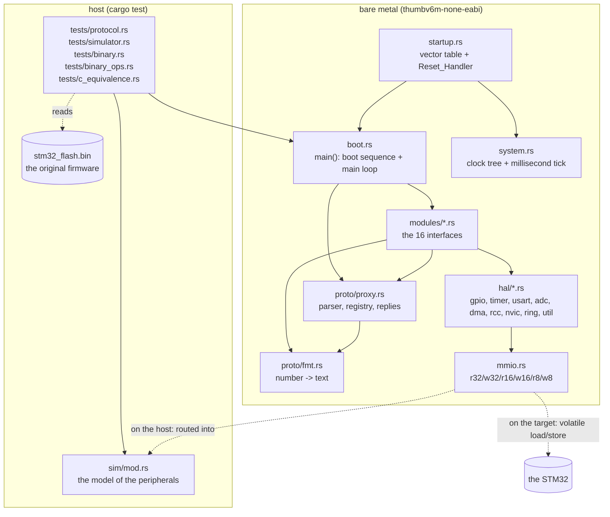
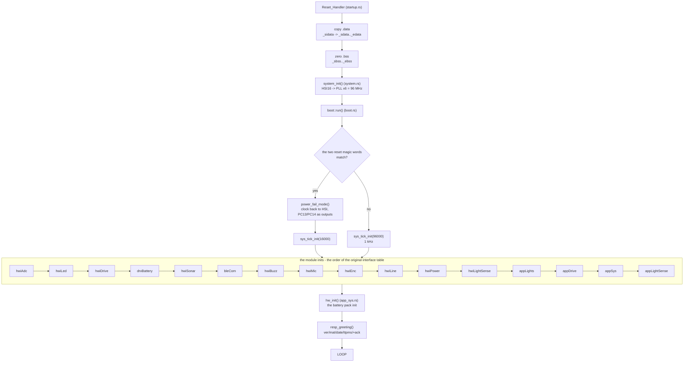
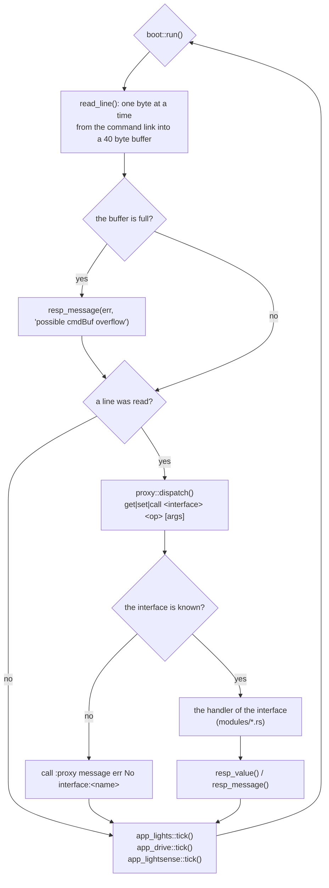
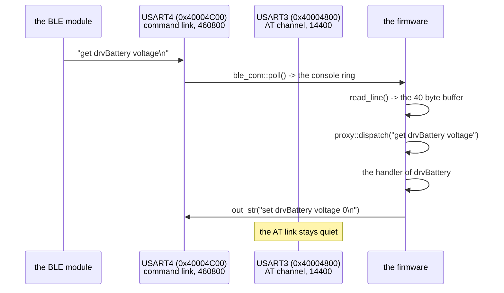

# Architecture of the Rust port

The flow graph of the files: what runs when, what calls what, and what every
file is responsible for.  Every Rust file names the C file it was ported
from; the C tree (`../fw`) is the reference implementation.

---

## 1. The layers

The only switch between the two worlds is `src/mmio.rs`: on the target the
accesses are volatile loads and stores, on the host they end up in the model
of `src/sim/`.  **No firmware code is duplicated for the tests.**

---

## 2. What runs when

### 2.1 The boot sequence

Every module registers itself in the interface registry of
`proto/proxy.rs` from its `init()` - in the order above, which is the order
of the interface table of the original firmware (flash `0x0800D164`).

### 2.2 The main loop

The line reader blocks until a byte arrives, so the periodic tasks only run
after a command has been read - exactly like the original.

### 2.3 A request on the wire

---

## 3. The files

| file | the type / the state it holds | what it does | the C file |
|---|---|---|---|
| `src/lib.rs` | - | the crate root, the module tree, the panic handler | - |
| `src/mmio.rs` | - | the register access: `r32/w32/r16/w16/r8/w8`, `rmw32/rmw16/rmw8` | the `REG32`/`REG16` macros |
| `src/state.rs` | `Global<T>` | the global state of the modules (the C file scope variables) | the C `static` variables |
| `src/hal/addr.rs` | the constants | the peripheral bases and the register offsets of the **original binary** | `hwi_a_hal.h`, `hwi_b_hal.h` |
| `src/hal/gpio.rs` | `Cfg`, `PerPinCfg` | the two GPIO flavours of `FUN_0800A964`, the alternate function, the read/write | `hwi_a_hal.c`, `hwi_b_hal.c` |
| `src/hal/timer.rs` | `BaseCfg`, `ChanCfg` | the timer setup of `FUN_0800AEC4`, the compare channels, the PWM helpers | `hwi_a_hal.c`, `hwi_b_hal.c` |
| `src/hal/usart.rs` | - | the USART setup (`FUN_0800B3FC`), the transmit/receive, the error flags | `hwi_b_hal.c` |
| `src/hal/adc.rs` | - | the ADC1 configuration, the conversion, the status flags | `hwi_a_hal.c` |
| `src/hal/dma.rs` | - | the DMA1 channels, the transfer count, the interrupt flags | `hwi_a_hal.c` |
| `src/hal/rcc.rs` | - | the AHB/APB2/APB1 clock enables | `hwi_a_hal.c`, `hwi_b_hal.c` |
| `src/hal/nvic.rs` | - | the interrupt enable and the priority | `hwi_a_hal.c` |
| `src/hal/ring.rs` | `Ring<N>` | the byte ring buffer | `hwi_b_hal.c` |
| `src/hal/util.rs` | - | the millisecond tick, the busy wait, the watchdog, `is_on`, `atoi`, `parse_args` | `hwi_b_hal.c` |
| `src/proto/proxy.rs` | `Iface`, the registry | the request parser, the interface registry, the three reply helpers | `proxy.c` |
| `src/proto/fmt.rs` | `Buf<N>` | the number formatting (`FUN_080068D4` / `FUN_0800693C`) | `proxy.c` |
| `src/proto/catalog.rs` | the string catalog | the protocol strings as NUL terminated literals in `.rodata`, so that they stay individually recoverable in the image like the string table of the original | the string table of the original |
| `src/system.rs` | the millisecond tick | the clock tree (`FUN_08002958`), the SysTick | `system_stm32g0.c` |
| `src/startup.rs` | the vector table | the 48 vectors, the reset handler, the default handler | `startup_stm32g071.c`, `startup_handlers.c`, `startup_vectors.h` |
| `src/boot.rs` | the reset magic | `main()`: the boot sequence and the main loop | `main.c` |
| `src/sim/mod.rs` | the model | the model of the USARTs, the ADC and the timer counters (host only) | `tools/host_sim.c` |
| `tests/protocol.rs` | - | the protocol against the exact bytes of the original | `tools/protocol_test.c` |
| `tests/simulator.rs` | - | the whole firmware against the model of the peripherals | `tools/host_sim.c` |
| `tests/binary.rs` | - | the port against the **dump**: the interface table, the version block, the vector table, the register map | the analysis of the dump |
| `tests/binary_ops.rs` | - | the ops of the original and the exact bytes of their answers | `analysis/INTERFACE_OPS.txt` |
| `tests/c_equivalence.rs` | - | the port against the **C firmware**: the same scenario, the same bytes | `tools/host_sim.c` + `rust/tests/data/c_sim.txt` |
| `tests/data/c_sim.txt` | the golden facts | the observable behaviour of the C firmware, captured from the C simulator | `tools/capture_c_sim.sh` |

---

## 4. The 16 interfaces

The order is the order of the table of the original firmware (flash
`0x0800D164`); the dispatcher searches the table backwards.

| # | interface | file | what the handler answers | the original |
|---|---|---|---|---|
| 0 | `hwiAdc` | `modules/hwi_adc.rs` | `get buf`: the 32 raw samples, one per line | `FUN_080073DC` |
| 1 | `hwiLed` | `modules/hwi_led.rs` | `on`, `pwm`, the number of dark LEDs | a stub in the original |
| 2 | `hwiDrive` | `modules/hwi_drive.rs` | `dutyA` / `dutyB` (no reply), `nFault` -> "0" | `FUN_08008B3C` |
| 3 | `drvBattery` | `modules/drv_battery.rs` | `voltage`, `temp`, `current`, `remainingCapacity`, `chargeStat` (hex!), `hwInit` | `FUN_08006F2C` |
| 4 | `hwiSonar` | `modules/hwi_sonar.rs` | nothing (a stub in the original) | `FUN_08009F88` |
| 5 | `bleCom` | `modules/ble_com.rs` | `buf`, `write`, `echo` | `FUN_0800837C` |
| 6 | `hwiBuzz` | `modules/hwi_buzz.rs` | `play`, `stop` | `FUN_08008490` |
| 7 | `hwiMic` | `modules/hwi_mic.rs` | `level` | `FUN_0800962C` |
| 8 | `hwiEnc` | `modules/hwi_enc.rs` | nothing (a stub in the original) | `FUN_08008DFC` |
| 9 | `hwiLine` | `modules/hwi_line.rs` | `read`, `mask` | `FUN_08009478` |
| 10 | `hwiPower` | `modules/hwi_power.rs` | `pwrOff` (never returns), `Vsens` | `FUN_0800981C` |
| 11 | `hwiLightSense` | `modules/hwi_lightsense.rs` | `read`, `level` | `FUN_080093A9` |
| 12 | `appLights` | `modules/app_lights.rs` | nothing (a stub in the original) | `FUN_08005F00` |
| 13 | `appDrive` | `modules/app_drive.rs` | nothing (a stub in the original) | `FUN_08003848` |
| 14 | `appSys` | `modules/app_sys.rs` | `ver`, `mat`, `date`, `ttpms`, `hwInit` | `FUN_080064F0` |
| 15 | `appLightSense` | `modules/app_lightsense.rs` | nothing (a stub in the original) | `FUN_08003854` |

---

## 5. The interrupts

| vector | handler | module | what it does |
|---|---|---|---|
| SysTick | `system::SysTick_Handler` | `system.rs` | the millisecond tick |
| IRQ 9 | `DMA1_Channel1_IRQHandler` | `modules/hwi_sonar.rs` | the end of a sonar capture |
| IRQ 13 | `TIM1_BRK_UP_TRG_COM_IRQHandler` | `modules/hwi_enc.rs` | the high part of encoder 2 |
| IRQ 15 | `TIM2_IRQHandler` | `modules/hwi_enc.rs` | the high part of encoder 1 |
| IRQ 22 | `TIM17_IRQHandler` | `modules/hwi_sonar.rs` | the end of a sonar measurement |
| the other 27 | `startup::Default_Handler` | `startup.rs` | an endless loop, like the original |

---

## 6. The two serial links

| | **USART3** `0x40004800` | **USART4** `0x40004C00` |
|---|---|---|
| role | the AT channel to the BLE module | **the commands in, every reply out** |
| pins | PB1 + PB13 (AF4), PC4 + PC5 (AF1), PA2 in | PC10 (TX) / PC11 (RX), AF0, pull up |
| baud | 14400, 2 stop bits | 460800 |
| traffic | "BLE-boot", "PPRT"/"PPRET", the answers of the module | the commands, the greeting, the values, the errors |

`out_str()` and `out_char()` - and therefore the greeting, every value reply
and every error message - go out on **USART4**.  This is the behaviour of
the original binary (the literal pool of its output primitives holds
`0x40004C00`), see `../MEMORY.md` section 4.2.

---

## 7. The memory map (of the original binary, not of a data sheet)

| peripheral | base | used by |
|---|---|---|
| GPIOA / B / C / F | `0x48000000` / `0x48000400` / `0x48000800` / `0x48001400` | the pin maps of the modules |
| TIM1 / TIM2 / TIM3 | `0x40012C00` / `0x40000000` / `0x40000400` | the encoders, the motor PWM |
| TIM15 / TIM16 / TIM17 | `0x40014000` / `0x40014400` / `0x40014800` | the LEDs, the buzzer, the sonar |
| ADC1 | `0x40012400` | the ADC, the microphone, the line sensors, the light sensor |
| DMA1 (+ ch1..ch7) | `0x40020000` | the ADC samples, the sonar capture, the LED pattern |
| USART3 / USART4 | `0x40004800` / `0x40004C00` | the two links |
| RCC / FLASH | `0x40021000` / `0x40022000` | the clock tree |
| SYSCFG / EXTI / IWDG | `0x40010000` / `0x40010400` / `0x40003000` | the power good line, the watchdog |

---

## 8. The oracles of the port

The port is checked against four independent references:

| oracle | what it checks | where |
|---|---|---|
| **the golden bytes** | the protocol layer: the greeting, the value reply, the error messages, the number formatting | `tests/protocol.rs` (the counterpart of `tools/protocol_test.c`) |
| **the peripheral model** | the whole firmware: the boot output, the replies, the motor duty registers, the baud divisors | `tests/simulator.rs` (the counterpart of `tools/host_sim.c`) |
| **the dump** | the original binary: the interface table at `0x0800D164`, the version block at `0x0800C65C`, the vector table, the ops of every interface, the register map | `tests/binary.rs`, `tests/binary_ops.rs` |
| **the C firmware** | the same scenario, the same bytes on the command link, the same register values - the facts are captured from the C simulator and replayed | `tests/c_equivalence.rs` + `tests/data/c_sim.txt` |

The dump is the ground truth, the C firmware is the reference implementation,
the golden bytes are the contract of the protocol.

---

## 9. The quirks that are reproduced on purpose

These are not bugs of the port - they are the behaviour of the original.

| quirk | where |
|---|---|
| the reply of a `get` carries the op word **"set"** | `drvBattery`, `hwiDrive nFault` |
| the sensor values are printed in **hexadecimal** | `drvBattery` |
| the duty argument is parsed as **hexadecimal** | `hwiDrive dutyA/dutyB` |
| a duty of zero drives both directions with the maximum (a brake) | `hwiDrive` |
| the interface table is searched **backwards** | `proto::dispatch` |
| the "extra" of a system message is appended **without a separator** | `proto::resp_message` |
| the output type of a GPIO is shifted as a **whole byte** (it also touches the next pin) | `hal::gpio::config` |
| the compare register is written with **32 bits** (it also clears the next channel) | `hal::timer::pwm_set` |
| the "BLE-boot" message goes out on the **command** link | `modules::ble_com` |
| the LED pattern engine prints "PPRT\n" / "PPRET\n" on the command link | `modules::hwi_led`, `modules::app_lights` |
| `hwiEnc` and `hwiSonar` answer **nothing** | `modules::hwi_enc`, `modules::hwi_sonar` |
